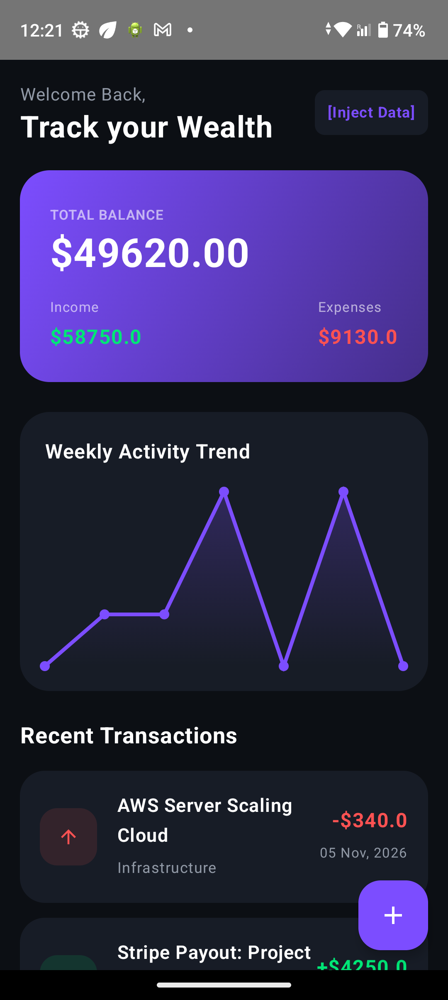

# Capitall 💰📱

**Capitall** is a modern, high-performance Android personal finance and wealth management application built from scratch using **Jetpack Compose** and **Clean Architecture**. Designed with a sleek Dark Theme and biometric security, Capitall helps users track income, monitor expenses, and visualize financial growth effortlessly.

---

## 🌟 Key Features

- **🔒 Biometric Security & Authentication:** Secure app access using Android BiometricPrompt (Fingerprint/Face unlock) with a seamless fallback/test-mode bypass for rapid portfolio demonstration.
- **📊 Interactive Analytics & Charts:** Custom-built financial analytics charts displaying spending distribution and income/expense trends.
- **💸 Transaction Management:** Add, categorize, and track income and expenses in real-time with automatic database persistence.
- **🏛️ Clean Architecture & MVVM:** Robust separation of concerns across Domain, Data, and Presentation layers ensuring testability, maintainability, and scalability.
- **💾 Local Persistence with Room:** Offline-first architecture powered by SQLite/Room with Coroutines and StateFlow reactive UI updates.
- **🎨 Modern Material 3 UI:** Crafted with Jetpack Compose following Material 3 design guidelines, smooth animations, and custom dark mode styling.

---

## 🛠️ Tech Stack & Architecture

- **UI Toolkit:** Jetpack Compose, Material 3, Accompanist / Custom Animations (`Crossfade`, smooth transitions)
- **Architecture:** Clean Architecture + MVVM (Model-View-ViewModel)
- **Concurrency:** Kotlin Coroutines & Flow
- **Local Database:** Room Database with DAO and Entity mapping
- **Security:** AndroidX Biometric API
- **Language:** 100% Kotlin

---

## 📁 Project Structure

```text
com.portfolio.capitall/
│
├── data/
│   ├── local/          # Room Database, DAOs, Entities, Mappers
│   └── repository/     # FinanceRepository implementation
│
├── domain/
│   ├── model/          # Core Domain models (Transaction, etc.)
│   ├── repository/     # Repository interfaces
│   └── usecase/        # Business logic use cases (Add/Get transactions)
│
├── presentation/
│   ├── auth/           # Biometric authentication screen & manager
│   ├── components/     # Reusable UI components (AnalyticsChart, TransactionRow)
│   └── dashboard/      # Dashboard screen, ViewModel, BottomSheets
│
└── ui/
    └── theme/          # Color palette, Typography, Theme setup
```

---

## 🚀 Getting Started

1. **Clone the repository:**
   ```bash
   git clone https://github.com/RaviYadavO4/capitall.git
   ```
2. **Open in Android Studio:**
   - Open Android Studio and select **Open an Existing Project**.
   - Navigate to the cloned `Capitall` folder.
3. **Build & Run:**
   - Sync Gradle and run the app on an Android emulator or physical device (API 24+).

---

## 📸 App Preview & Screenshots

### Dashboard


### App Demo Video
Watch the quick app walkthrough video here:  
👉 [Download / View Demo Video](screenshots/demo.mp4)

---

## 👨‍💻 Author

Built with passion as part of Android Developer Portfolio.  
GitHub: [RaviYadavO4](https://github.com/RaviYadavO4)

---

## 👨‍💻 Author

Built with passion as part of Android Developer Portfolio.  
Feel free to reach out or explore other repositories!
